# ⚔️ ML Arena

**Registre, processe e coloque modelos de Machine Learning para "batalhar" lado a lado.**

Uma versão enxuta do MLflow: cada **run** guarda algoritmo, hiperparâmetros e métricas; um CSV de
*medido × previsto* é processado **de forma assíncrona** e vira dois gráficos; e a tela
**Model Battle** compara dois runs.

> **Trabalho Prático 2** de Desenvolvimento de Software para Nuvem (UFC). A aplicação do Trabalho 1,
> que usava serviços gerenciados da AWS, agora roda **inteira em containers com um único comando**.
> Só o DynamoDB continua na AWS, como pede o enunciado.

| Repositório | Conteúdo |
|---|---|
| **ml-arena-backend-v2** (este) | API, worker, Docker Compose, Kubernetes e esta documentação |
| [ml-arena-frontend-v2](https://github.com/arthcf/ml-arena-frontend-v2) | Interface web |

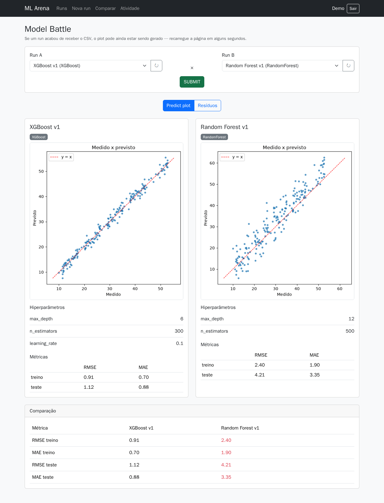

---

## 🧭 Índice

1. [Começo rápido](#-começo-rápido)
2. [Da AWS para os containers](#-da-aws-para-os-containers)
3. [Arquitetura](#-arquitetura)
4. [O caminho de um upload](#-o-caminho-de-um-upload)
5. [Mensageria e resiliência](#-mensageria-e-resiliência)
6. [Armazenamento e dados](#-armazenamento-e-dados)
7. [Docker e Docker Compose](#-docker-e-docker-compose)
8. [Kubernetes (extra)](#-kubernetes-extra)
9. [Decisões de projeto](#-decisões-de-projeto)
10. [Evidências de funcionamento](#-evidências-de-funcionamento)
11. [Limitações e pendências](#-limitações-e-pendências)
12. [Roteiro de demonstração e perguntas](#-roteiro-de-demonstração-e-perguntas)
13. [Referência](#-referência)

---

## 🚀 Começo rápido

**Pré-requisitos:** Git e Docker com o plugin Compose v2 (`docker compose version`).

```bash
# 1. Baixe os DOIS repositórios na mesma pasta (o compose constrói o frontend a partir do vizinho)
git clone https://github.com/arthcf/ml-arena-backend-v2.git
git clone https://github.com/arthcf/ml-arena-frontend-v2.git
cd ml-arena-backend-v2

# 2. Configure
cp .env.example .env          # preencha as variáveis da tabela abaixo

# 3. Gere as imagens e suba tudo
docker compose up -d --build

# 4. Confira: serviços "healthy"; migrate e minio-init "Exited (0)"
docker compose ps -a
```

No `.env`, preencha:

| Variável | O que colocar |
|---|---|
| `DB_USER`, `DB_PASSWORD` | Qualquer valor; criam o usuário do banco |
| `SECRET_KEY`, `FRONTEND_SECRET_KEY` | Dois segredos **diferentes**: `python3 -c 'import secrets; print(secrets.token_urlsafe(32))'` |
| `MINIO_ROOT_USER`, `MINIO_ROOT_PASSWORD` | Qualquer valor (senha com **8+ caracteres**) |
| `RABBITMQ_USER`, `RABBITMQ_PASSWORD` | Qualquer valor |
| `AWS_ACCESS_KEY_ID`, `AWS_SECRET_ACCESS_KEY`, `AWS_SESSION_TOKEN` | Opcional para subir. Necessárias só para a auditoria (AWS Learner Lab → *AWS Details* → *AWS CLI*) |

> Em senhas, evite `$`: o Compose o interpreta como início de variável.

Os demais valores já vêm preenchidos. Se faltar um usuário, uma senha ou um dos segredos, o Compose
para com a mensagem `defina ... no .env`.

| Abra | Endereço | Login |
|---|---|---|
| 🖥️ **Aplicação** | http://localhost:8001 | crie uma conta |
| 📘 Documentação da API | http://localhost:8000/docs | — |
| 🪣 Console do MinIO | http://localhost:9001 | `MINIO_ROOT_USER` / `MINIO_ROOT_PASSWORD` |
| 🐇 Painel do RabbitMQ | http://localhost:15672 | `RABBITMQ_USER` / `RABBITMQ_PASSWORD` |

**Para experimentar:** crie dois runs, envie [`samples/modelo_a.csv`](samples/modelo_a.csv) em um e
[`samples/modelo_b.csv`](samples/modelo_b.csv) no outro, espere o status `done` e abra **Comparar**.

**Teste automatizado** (precisa de `curl` e `python3`): `bash scripts/e2e.sh`.

```bash
docker compose down       # para tudo e mantém os dados
docker compose down -v    # para tudo e APAGA banco, arquivos e fila
```

---

## 🔄 Da AWS para os containers

| Trabalho 1 (AWS) | Trabalho 2 | Imagem | Quanto o código mudou |
|---|---|---|---|
| RDS | Container **Postgres** | `postgres:15-alpine` | Só configuração |
| S3 | Container **MinIO** ([Silo](#sobre-a-imagem-do-minio)) | `pgsty/silo` | Pouco: outro endereço e outras credenciais |
| SNS + SQS | Container **RabbitMQ** | `rabbitmq:4.2-management-alpine` | Bastante: publicação e consumo reescritos |
| ElastiCache | Container **Redis** | `redis:7-alpine` | Só configuração |
| DynamoDB | **Continua na AWS** | — | Ganhou a **consulta** (`GET /api/v1/audit` e tela Atividade) |
| EC2, ALB, Auto Scaling, ECR | **Docker Compose** (e Kubernetes) | imagens próprias | Infraestrutura reescrita |

**O que não mudou:** modelo de dados, migrations, autenticação, regras de CRUD, validação do CSV,
geração dos gráficos e o cache.

---

## 🧱 Arquitetura

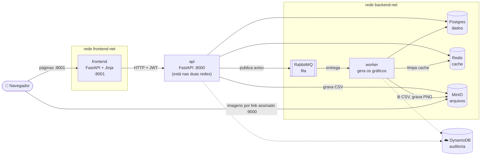

**Três ideias sustentam o desenho:**

1. **A API não faz trabalho pesado.** Ela valida, guarda o arquivo, deixa um aviso na fila e responde.
2. **API e worker não se conhecem.** Eles só compartilham a fila, o banco e o armazenamento. Dá para
   parar o worker sem derrubar a API.
3. **Cada um enxerga só o necessário.** O frontend alcança a API e nada mais.

---

## 📤 O caminho de um upload

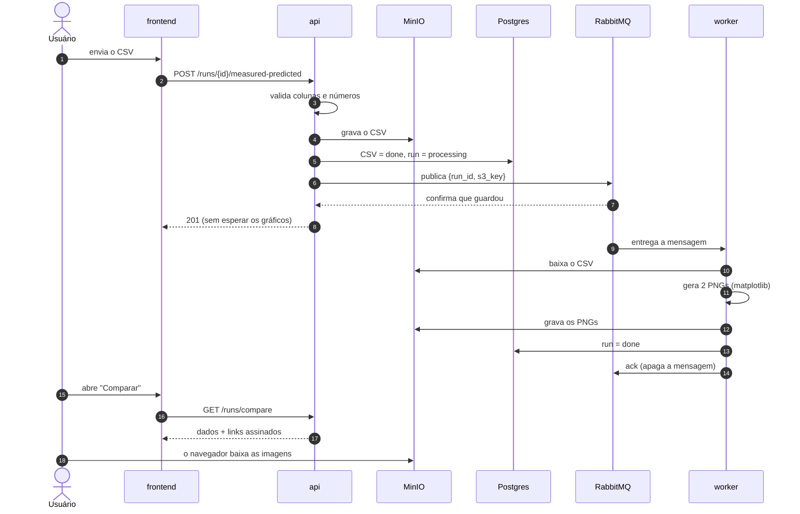

> **A ordem dos passos 5, 6 e 7 importa.** O banco é atualizado **antes** da publicação. O RabbitMQ
> entrega em milissegundos: se a ordem fosse inversa, o worker poderia chegar antes de o CSV constar
> como pronto e reprovar o run sem motivo.

---

## 🐇 Mensageria e resiliência

### Topologia

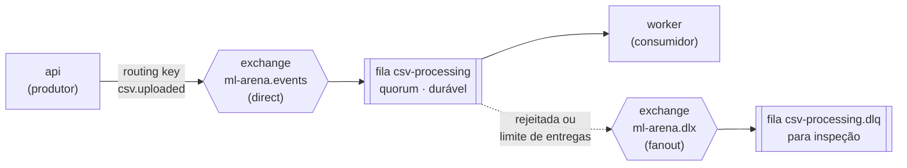

| RabbitMQ | Papel | Equivalente no Trabalho 1 |
|---|---|---|
| Exchange | Recebe e roteia | Tópico SNS |
| Queue | Guarda até alguém consumir | Fila SQS |
| Binding | Liga exchange e fila | Inscrição da fila no tópico |
| `ack` | "Feito, pode apagar" | `delete_message` |
| `nack` com requeue | "Devolva, tento de novo" | Fim do *visibility timeout* |
| DLQ | Guarda o que não deu para processar | DLQ da SQS |

### Como o worker decide

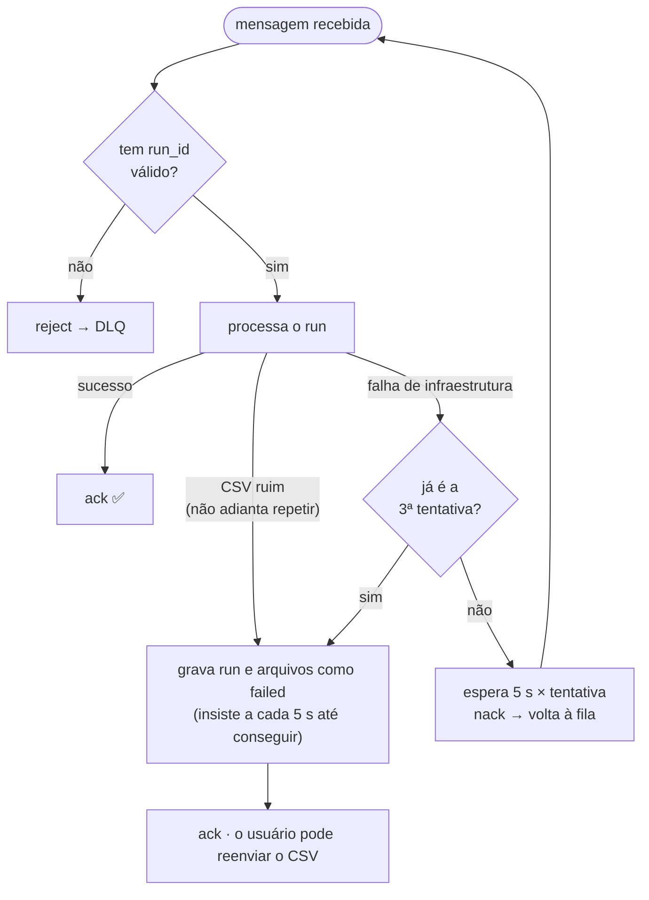

### Falhas que foram provocadas de propósito

| Cenário | Resultado observado |
|---|---|
| Worker parado durante o upload | API responde 201; a mensagem **espera na fila** e é processada quando o worker volta |
| RabbitMQ reiniciado com mensagem na fila | A mensagem **sobrevive** e é processada |
| RabbitMQ fora durante o upload | API responde 502; run `failed`; **o reenvio funciona** |
| MinIO fora durante o processamento | 3 tentativas; run `failed`; **o reenvio funciona** |
| Postgres fora durante o processamento | 3 tentativas; o worker segura a mensagem até gravar `failed`; **o reenvio funciona** |

Logs reais dos dois últimos: [`09-recuperacao-de-falhas.txt`](assets/evidencias/09-recuperacao-de-falhas.txt).

**Garantias usadas:** fila e exchange duráveis, mensagem persistente, *publisher confirms* (a API só
considera publicado quando o broker confirma) e `prefetch_count=1`. A entrega é *pelo menos uma vez*,
por isso o worker ignora um run que já está `done`.

> **Detalhe medido no RabbitMQ 4.2:** `x-delivery-limit` conta *devoluções*. Com limite N há N + 1
> entregas, então o limite 2 dá as 3 tentativas. O cabeçalho `x-delivery-count` não vem na 1ª entrega.

---

## 💾 Armazenamento e dados

### Arquivos no MinIO

```
ml-arena/                         ← bucket privado, criado pelo container minio-init
└── runs/{id}/
    ├── measured_predicted.csv    ← enviado pelo usuário
    └── plots/
        ├── measured_predicted.png    ← gerados pelo worker
        └── residuals.png             (os arquivos binários da aplicação)
```

**O MinIO fala a mesma API do S3.** Por isso o código continua usando a biblioteca `aioboto3`: muda
apenas o `endpoint_url` e as credenciais. Nenhuma requisição vai para a AWS.

**Por que existem duas URLs do MinIO?**

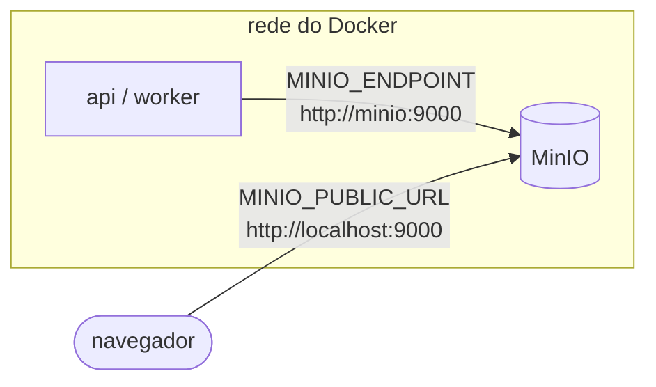

O navegador não conhece o nome `minio`, que só existe dentro do Docker. Os links temporários
(5 minutos) são assinados com a URL pública, porque **o host faz parte da assinatura**: não dá para
trocá-lo depois.

### Postgres

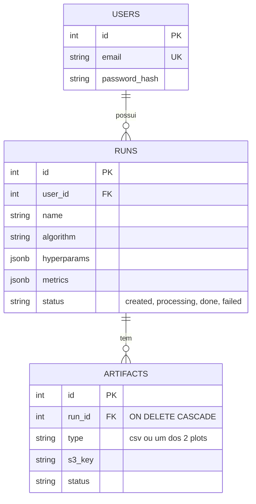

`hyperparams` e `metrics` são `JSONB` porque cada algoritmo tem campos diferentes. As tabelas são
criadas pelo Alembic, no container `migrate`.

### Redis (cache)

A listagem de runs fica em cache por 300 s, com uma chave por usuário e filtros. O cache é
invalidado quando o usuário altera um run e quando o worker termina.

### DynamoDB (auditoria)

| Chave | Valor | Para quê |
|---|---|---|
| `user_id` (partição) | `"7"` | Agrupa as ações de um usuário |
| `timestamp` (ordenação) | `2026-11-25T12:00:00+00:00#abcd1234` | Ordena por hora; o sufixo evita colisão |

Cada item registra o **tipo da ação**, os **dados manipulados** e a **hora**; senhas são mascaradas.
A gravação roda em segundo plano, então uma falha do DynamoDB não quebra o CRUD. A consulta
(`GET /api/v1/audit`) usa `Query` na partição do usuário do token, sem `Scan`.

---

## 🐳 Docker e Docker Compose

### Imagens

| Imagem | Dockerfile | Usada por |
|---|---|---|
| `ml-arena-backend` | [`Dockerfile`](Dockerfile) deste repositório | `api`, `worker` e `migrate` |
| `ml-arena-frontend` | `Dockerfile` do frontend | `frontend` |

**Por que o worker não tem um Dockerfile próprio?** Ele importa o mesmo pacote `app` e usa as mesmas
dependências. Seria uma cópia. O que muda é o comando: `fastapi run`, `python -m worker.consumer` ou
`alembic upgrade head`.

Os dois Dockerfiles:
- instalam **exatamente** o `uv.lock` (`uv sync --frozen`), para o build ser reproduzível;
- copiam as dependências **antes** do código, para mudar o código não reinstalar tudo;
- rodam com um **usuário sem privilégios** (`app`);
- usam `.dockerignore`, para o `.env` nunca entrar na imagem.

### Ordem de subida

Uma seta significa "só começa depois que o anterior estiver pronto".

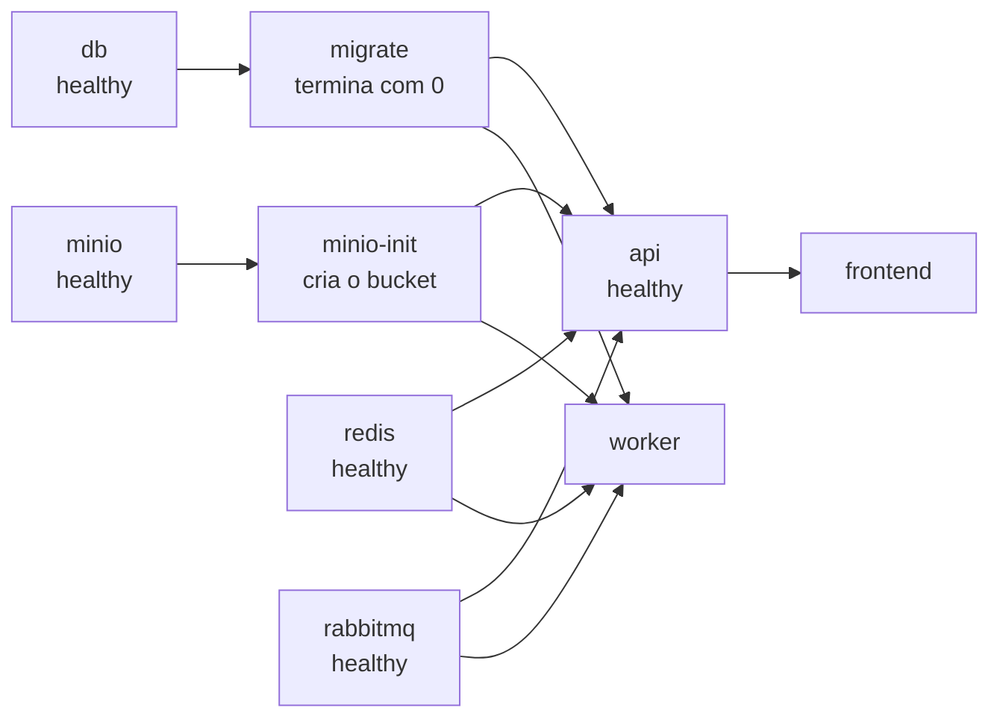

**"Ligado" não é "pronto".** Cada `depends_on` usa uma condição (`service_healthy` ou
`service_completed_successfully`), apoiada em um *healthcheck* real: `pg_isready`, `redis-cli ping`,
porta AMQP aberta e `/health`.

### Redes, portas e volumes

| Serviço | Rede | Porta no host |
|---|---|---|
| `frontend` | frontend | 8001 |
| `api` | frontend + backend | 8000 |
| `minio` | backend | 9000 (links) e 9001 (console) |
| `rabbitmq` | backend | 15672 (painel) |
| `db`, `redis`, porta AMQP | backend | **nenhuma** |
| `worker`, `migrate`, `minio-init` | backend | nenhuma |

- **Volumes** `postgres_data`, `minio_data` e `rabbitmq_data` mantêm os dados entre reinícios.
- **Sem bind mount:** o código vai dentro da imagem; quem clona roda exatamente o que foi construído.
- O RabbitMQ tem `hostname` fixo, porque os dados dele são gravados sob o nome do nó.
- Para escalar: `docker compose up -d --scale worker=2` (as réplicas dividem a fila).

### Configuração e segredos

O `.env` **não vai para o Git**; o [`.env.example`](.env.example) documenta cada variável. Usuários e
senhas não têm valor padrão (`${VAR:?mensagem}`).

---

## 🚢 Kubernetes (extra)

A mesma aplicação sobe num cluster local com [kind](https://kind.sigs.k8s.io/), no namespace
`ml-arena`. Os Services **NodePort** são acessíveis de fora; os **ClusterIP**, só dentro do cluster.

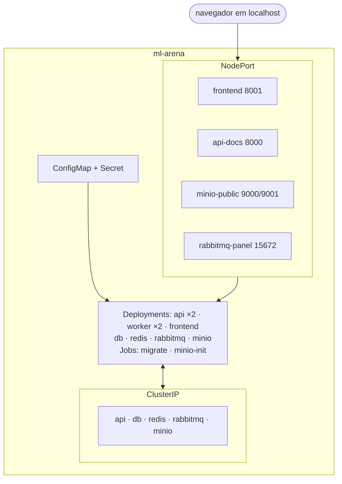

```bash
# Pré-requisitos: kind e kubectl; .env preenchido
docker compose down               # as portas são as mesmas
bash k8s/up.sh                    # cria o cluster, constrói, carrega as imagens e aplica tudo
K8S=1 bash scripts/e2e.sh         # o mesmo teste ponta a ponta, no cluster
kind delete cluster --name ml-arena
```

| No Compose | No Kubernetes |
|---|---|
| Serviço | Deployment (mantém os pods) + Service (endereço fixo) |
| `ports:` | Service **NodePort** |
| Rede interna | Service **ClusterIP** |
| `.env` | **ConfigMap** (não secreto) + **Secret** (senhas) |
| Volume | PersistentVolumeClaim |
| `depends_on` | initContainers e *probes* |
| `restart` | O Deployment recria o pod apagado |

- **Segredos:** o `up.sh` cria o Secret a partir do `.env`, sem gravá-lo no repositório (o arquivo
  versionado é um [exemplo com valores falsos](k8s/secret.example.yaml)). Atenção: Secret é
  **base64, não criptografia**; a proteção vem de não versionar e do controle de acesso.
- **`.env` no cluster:** nome do banco, bucket, região e tabela do `.env` têm prioridade sobre os
  padrões do ConfigMap.
- **WSL2:** o nó usa `kindest/node:v1.34.3`, versão fixa porque a mais nova testada (1.37) não subiu em
  máquina com **cgroup v1**. O `kind` avisa que esse suporte será removido no futuro.

---

## 🧠 Decisões de projeto

| Decisão | Por quê |
|---|---|
| **RabbitMQ**, não Kafka | Precisamos distribuir **tarefas** com confirmação, retry e DLQ. Kafka é um log de eventos para alta vazão e reprocessamento, e exigiria montar retry e DLQ à mão |
| **`aioboto3`** apontado para o MinIO, não o SDK `minio` | O SDK `minio` é síncrono e bloquearia a API; o `aioboto3` já era usado para o DynamoDB |
| **Fila quorum** | Conta as entregas (`x-delivery-count`), o que permite limitar tentativas |
| **Espera feita no worker** antes do `nack` | O `nack` devolve na hora; sem espera, as 3 tentativas acabariam em milissegundos |
| **CSV vira `failed` junto com o run** | Libera o reenvio sem apagar o run |
| **Worker insiste em gravar `failed`** | Se desistisse com o banco fora, o run ficaria travado para sempre |
| **Uma imagem** para API, worker e migrate | Mesmo código e mesmas dependências |
| **Duas redes** | O frontend não alcança banco, fila nem arquivos |
| **Um compose, dois repositórios** | Cada serviço mantém seu repositório; o compose constrói o vizinho |

### Sobre a imagem do MinIO

A MinIO Inc. deixou de publicar as imagens da edição comunitária (`minio/minio`) e arquivou o
repositório em 2026. Usamos o **Silo** (`pgsty/silo`), um fork comunitário que mantém a API S3, as
variáveis `MINIO_ROOT_*`, as portas 9000/9001 e o console web. O cliente de linha de comando se
chama `mcli`. A tag é fixa.

---

## 📸 Evidências de funcionamento

### Aplicação

| Lista de runs | Novo run |
|---|---|
| 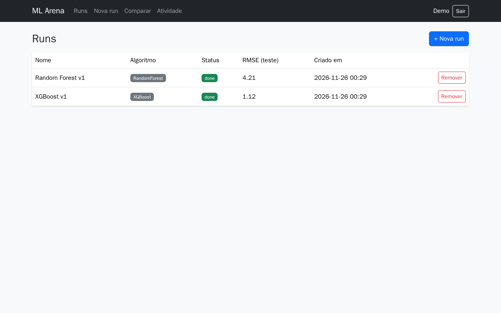 | 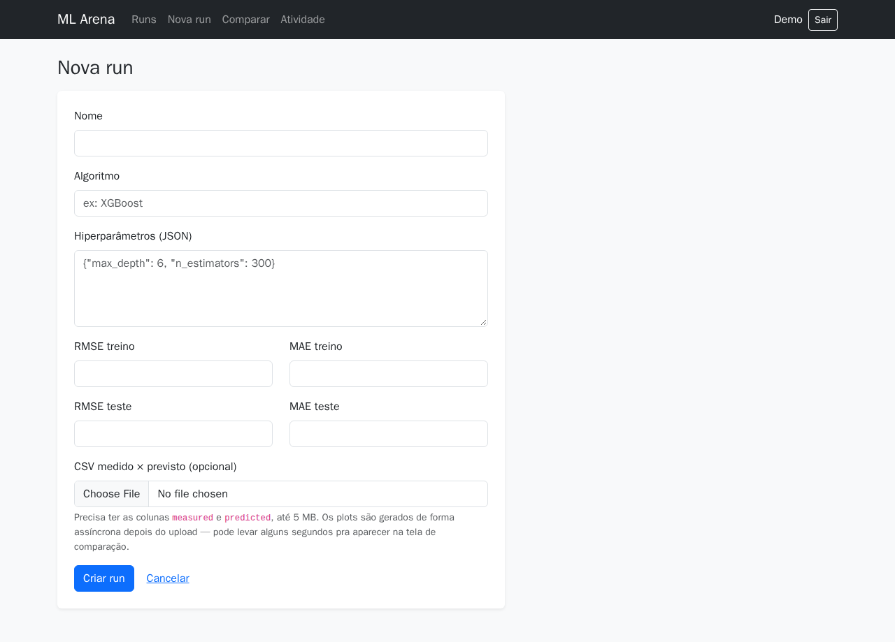 |

| Gráfico de resíduos | API (Swagger) |
|---|---|
| 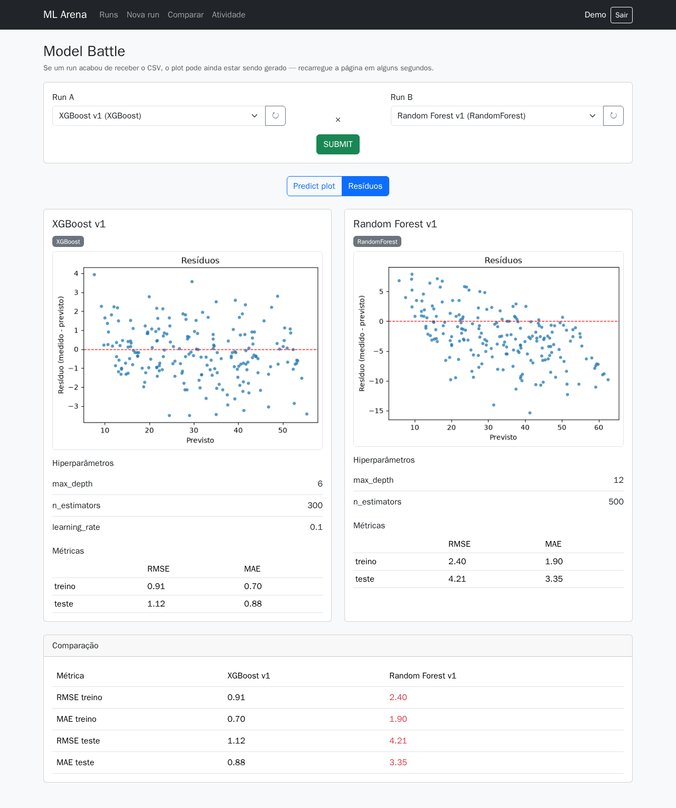 | 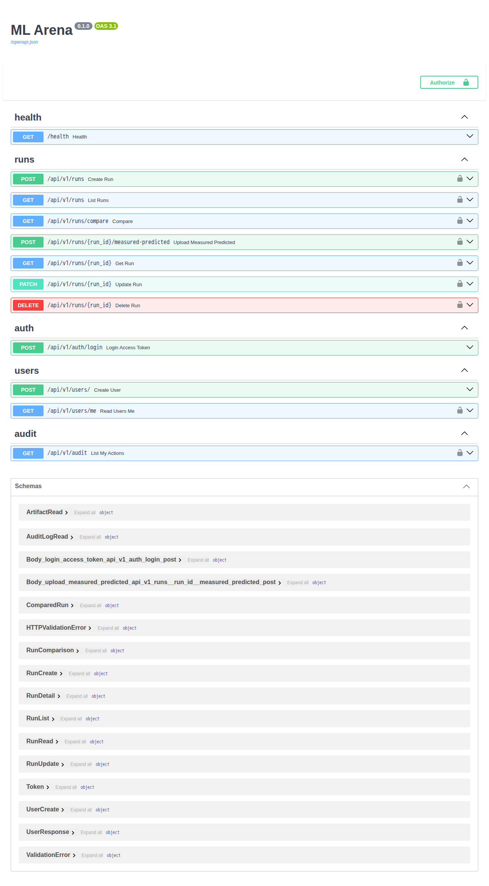 |

### MinIO: os gráficos gravados pelo worker

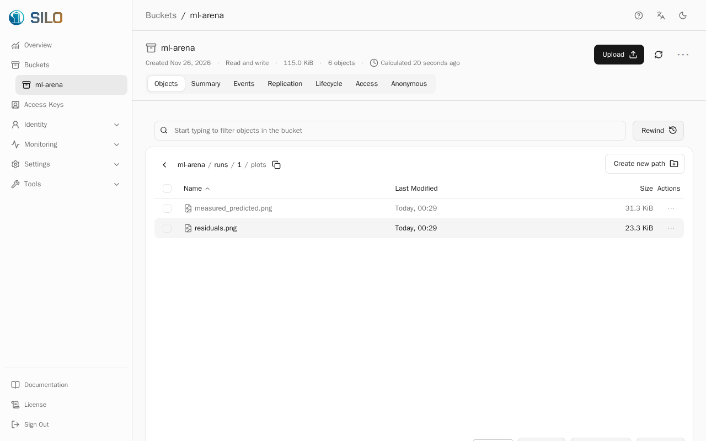

### RabbitMQ

**Desacoplamento:** com o worker parado, a mensagem aguarda na fila (`Ready = 1`).

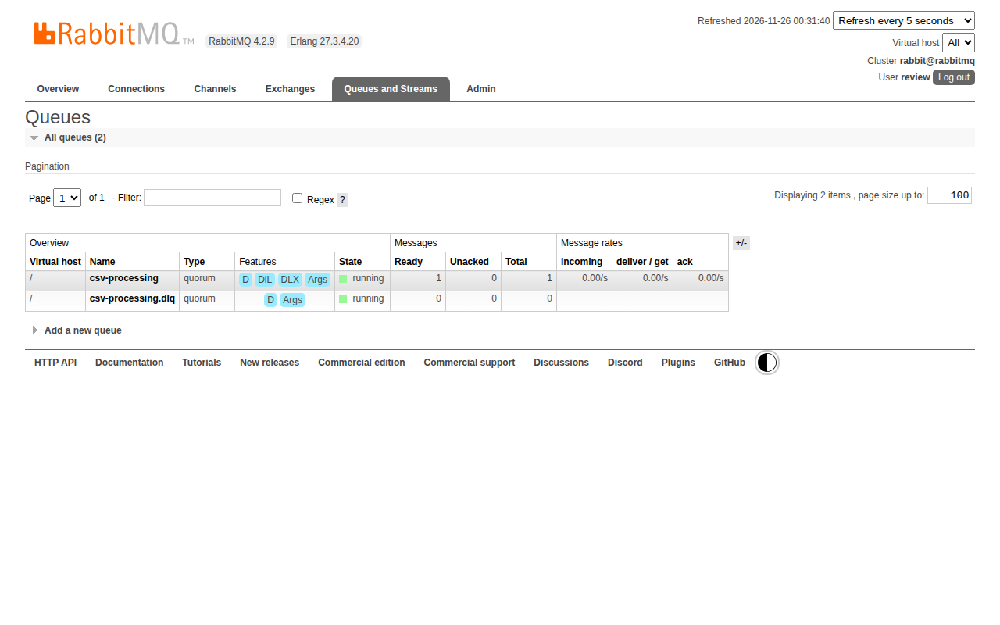

| Filas vazias após o processamento | Exchange e binding |
|---|---|
|  | 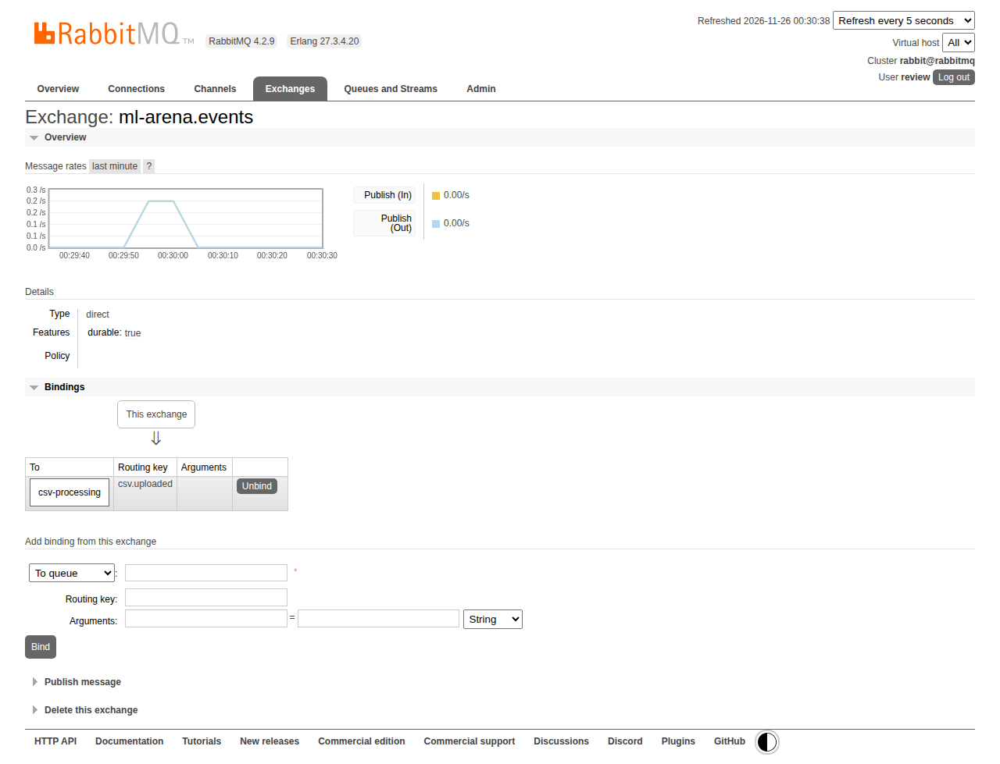 |

### Saídas de terminal

| Arquivo | O que mostra |
|---|---|
| [`01-compose-ps.txt`](assets/evidencias/01-compose-ps.txt) | Serviços no ar; `migrate` e `minio-init` com exit 0 |
| [`02-e2e.txt`](assets/evidencias/02-e2e.txt) | Teste ponta a ponta no Compose |
| [`03-rabbitmq.txt`](assets/evidencias/03-rabbitmq.txt) | Filas quorum e bindings |
| [`04-minio-objetos.txt`](assets/evidencias/04-minio-objetos.txt) | CSVs e PNGs no bucket |
| [`05-postgres.txt`](assets/evidencias/05-postgres.txt) | Runs e artifacts persistidos |
| [`06-worker-logs.txt`](assets/evidencias/06-worker-logs.txt) | Worker consumindo (etapas 1, 2 e 3) |
| [`07-redes.txt`](assets/evidencias/07-redes.txt) | O frontend alcança só a API |
| [`08-kubernetes.txt`](assets/evidencias/08-kubernetes.txt) | Pods, Services, teste no cluster, autocura e Secret |
| [`09-recuperacao-de-falhas.txt`](assets/evidencias/09-recuperacao-de-falhas.txt) | MinIO e Postgres derrubados e recuperados |

---

## 🚧 Limitações e pendências

| Item | Situação |
|---|---|
| **DynamoDB com a AWS real** | **Ainda não validado neste trabalho.** A consulta tem testes com tabela falsa; sem credenciais, a tela Atividade mostra "Auditoria indisponível" e o resto funciona. Veja o [roteiro de validação](#validar-o-dynamodb) |
| Editar um run pela interface | A API tem `PATCH /runs/{id}` (use o `/docs`); o frontend não tem essa tela |
| Mensagens na DLQ | Ficam para inspeção manual; não há reprocessamento automático |
| Worker que morre várias vezes na mesma mensagem | A mensagem vai para a DLQ e o run pode ficar em `processing` |
| Queda muito longa do banco | O RabbitMQ tem um prazo para o `ack` (30 min por padrão). Esse caso não foi testado |
| Credenciais do MinIO | A aplicação usa o usuário raiz; em produção seria um usuário restrito ao bucket |
| Alta disponibilidade | Banco, fila e MinIO têm uma única instância, e não há Auto Scaling |

---

## 🎤 Roteiro de demonstração e perguntas

**Demonstração (cerca de 5 minutos)**

1. `docker compose up -d --build` e `docker compose ps -a`.
2. Na aplicação: criar dois runs, enviar os CSVs e abrir **Comparar**.
3. Mostrar os arquivos no console do MinIO.
4. `docker compose stop worker`, enviar um CSV e mostrar `Ready = 1` no RabbitMQ.
5. `docker compose start worker` e ver o run virar `done`.
6. Mostrar as redes: `docker compose exec frontend python -c "import socket; socket.create_connection(('db',5432),3)"` **falha**.

**Perguntas prováveis**

<details><summary>Por que usar uma fila em vez de gerar o gráfico na própria requisição?</summary>

A requisição ficaria presa ao processamento. Com a fila, a API responde logo, o trabalho pode ser
repetido se falhar e dá para aumentar o número de workers sem mexer na API.
</details>

<details><summary>O que acontece se o worker cair no meio do processamento?</summary>

Ele não enviou o <code>ack</code>, então o broker devolve a mensagem à fila e outro worker (ou o
mesmo, ao voltar) a processa.
</details>

<details><summary>Uma mensagem pode ser processada duas vezes?</summary>

Pode: a entrega é "pelo menos uma vez". O worker ignora runs que já estão <code>done</code>, e os
arquivos têm nomes fixos, então repetir sobrescreve em vez de duplicar.
</details>

<details><summary>MinIO é o S3?</summary>

Não. É outro servidor que implementa a mesma API. O código fala o mesmo protocolo, mas com um
container nosso.
</details>

<details><summary>Qual a diferença entre healthcheck e depends_on?</summary>

O healthcheck diz <em>quando</em> um serviço está pronto. O <code>depends_on</code> com condição faz
outro serviço <em>esperar</em> por isso. Sem condição, ele só garante a ordem de início.
</details>

<details><summary>Por que o DynamoDB continua na AWS?</summary>

O enunciado exige. Como os containers não têm IAM role, as credenciais chegam pelo <code>.env</code>.
</details>

<details><summary>Compose ou Kubernetes: qual a diferença?</summary>

O Compose descreve containers em <strong>uma</strong> máquina. O Kubernetes mantém um estado desejado
em um cluster: recria pods, controla réplicas e dá endereços estáveis com Services.
</details>

---

## 📚 Referência

### Endpoints

| Método | Rota | Descrição |
|---|---|---|
| `GET` | `/health` | Health check |
| `POST` | `/api/v1/users/` | Cadastra um usuário |
| `GET` | `/api/v1/users/me` | Usuário logado |
| `POST` | `/api/v1/auth/login` | Login (form-data); devolve o token JWT |
| `POST` | `/api/v1/runs` | Cria um run |
| `GET` | `/api/v1/runs` | Lista os runs (paginação, filtros e cache) |
| `GET` | `/api/v1/runs/compare?run_a=&run_b=` | Compara dois runs |
| `GET` | `/api/v1/runs/{id}` | Detalhe com artifacts |
| `PATCH` | `/api/v1/runs/{id}` | Edita um run |
| `DELETE` | `/api/v1/runs/{id}` | Apaga o run e os arquivos |
| `POST` | `/api/v1/runs/{id}/measured-predicted` | Envia o CSV (`measured,predicted`) |
| `GET` | `/api/v1/audit?limit=` | Últimas ações do usuário (DynamoDB) |

### Validar o DynamoDB

A tabela precisa ter partition key `user_id` e sort key `timestamp`, ambas String. O nome vai em
`DYNAMODB_AUDIT_TABLE`.

1. Preencha as 3 credenciais no `.env`.
2. `docker compose up -d --force-recreate api worker`.
3. Faça login, crie um run e envie um CSV.
4. Abra **Atividade**: devem aparecer `LOGIN`, `CREATE_RUN`, `UPLOAD_CSV` e `PROCESS_RUN_DONE`.
5. No console da AWS: DynamoDB → Tables → sua tabela → *Explore items*.

### Solução de problemas

| Sintoma | Solução |
|---|---|
| `defina XXX no .env` | Preencha a variável |
| `container name ... is already in use` | Há containers antigos com o mesmo nome. Veja com `docker ps -a` e remova o projeto antigo com `docker compose -p <projeto> down` |
| **Atividade** indisponível; log `Auditoria não gravada` | Credenciais da AWS ausentes ou vencidas. Atualize o `.env` e recrie `api` e `worker` |
| `port is already allocated` | Outro programa usa 8000, 8001, 9000, 9001 ou 15672 |
| Imagens quebradas ao acessar de outra máquina | Ajuste `MINIO_PUBLIC_URL` para o endereço dela e recrie a `api` |
| Run parado em `processing` | `docker compose logs worker` e o painel do RabbitMQ |
| `api` não sobe | `docker compose logs migrate` |

### Desenvolvimento

Para rodar código no host contra os containers, descomente
`COMPOSE_FILE=docker-compose.yaml:compose.dev.yaml` no `.env` (publica banco, Redis e AMQP em
`127.0.0.1`).

```bash
uv run pytest                                   # testes (sem .env e sem Docker)
uv run ruff check . && uv run ruff format .
MINIO_ENDPOINT=http://localhost:9000 uv run python -m scripts.smoke_storage
RABBITMQ_HOST=localhost uv run python -m scripts.smoke_queue    # com o worker parado
```

### Estrutura

```
app/
├── api/            # rotas e dependências
├── schemas/        # formatos de entrada e saída (Pydantic)
├── services/       # regras de negócio, MinIO, RabbitMQ e auditoria
├── repositories/   # acesso ao Postgres e ao DynamoDB
├── core/           # configuração, segurança, cache, clientes MinIO e AWS
└── db/             # modelos, sessão e migrations
worker/             # consome a fila e gera os gráficos
tests/              # pytest
scripts/            # teste ponta a ponta e testes rápidos
samples/            # CSVs de exemplo
k8s/                # Kubernetes
assets/             # prints e evidências
docker-compose.yaml · compose.dev.yaml · Dockerfile · .env.example
```

> **Arquivo binário obrigatório:** o CSV de entrada é texto; o requisito é cumprido pelos **dois
> gráficos PNG** gerados pelo worker e guardados no MinIO.
