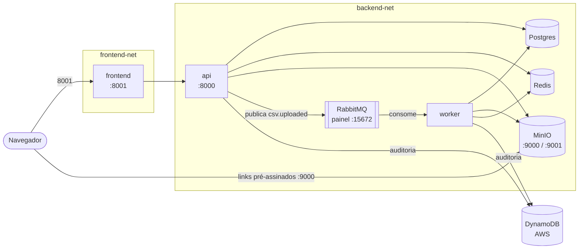

# ML Arena — backend

Uma versão simplificada do MLflow: registra **runs** de modelos de ML (hiperparâmetros e métricas),
recebe um CSV de medido×previsto, gera gráficos de forma assíncrona e compara dois runs lado a lado.

**Trabalho Prático 2** de Desenvolvimento de Software para Nuvem (UFC): a aplicação do Trabalho 1,
que rodava em serviços gerenciados da AWS, agora roda **inteira em containers com um único comando**
(`docker compose up`). Só o DynamoDB continua na AWS, como pede o enunciado.

Stack: FastAPI, SQLAlchemy 2.0 (async), PostgreSQL, Alembic, Redis, RabbitMQ (aio-pika),
MinIO (aioboto3), DynamoDB, uv e ruff. Frontend: [ml-arena-frontend-v2](https://github.com/arthcf/ml-arena-frontend-v2).

## Arquitetura



Fluxo do upload: a API valida o CSV, grava no MinIO e publica um aviso no RabbitMQ (exchange
`ml-arena.events` → fila `csv-processing`). O worker consome, baixa o CSV, gera os dois PNGs, grava no
MinIO e marca o run como `done` no Postgres. A tela de comparação recebe links pré-assinados do
MinIO e o navegador baixa as imagens direto dele.

### O que mudou em relação à AWS (Trabalho 1)

| Trabalho 1 (AWS) | Trabalho 2 (containers) | Imagem |
|---|---|---|
| RDS (Postgres) | Container `db` | `postgres:15-alpine` |
| S3 | Container `minio` | `pgsty/silo` (ver [nota sobre o MinIO](#nota-sobre-o-minio)) |
| SNS + SQS | Container `rabbitmq` (exchange → fila quorum → DLQ) | `rabbitmq:4.2-management-alpine` |
| ElastiCache | Container `redis` | `redis:7-alpine` |
| DynamoDB | **Continua na AWS** (credenciais do Learner Lab) | — |
| EC2 + ALB + Auto Scaling + ECR | Docker Compose ([Kubernetes](#kubernetes-extra) como extra) | `ml-arena-backend`, `ml-arena-frontend` |

## Pré-requisitos

- **Docker** com o plugin **Compose v2** (`docker compose version`).
- **Git**. Os dois repositórios precisam ficar **lado a lado** na mesma pasta: o compose constrói o
  frontend a partir de `../ml-arena-frontend-v2`.
- Para a auditoria (DynamoDB): uma sessão do **AWS Learner Lab** com a tabela `ml-arena-audit`
  (partition key `user_id`, sort key `timestamp`, ambas String). Sem ela a aplicação funciona
  normalmente; só a auditoria não grava (ver [Solução de problemas](#solução-de-problemas)).

## Como executar

```bash
# 1. Baixar o código (os dois repositórios na mesma pasta)
git clone https://github.com/arthcf/ml-arena-backend-v2.git
git clone https://github.com/arthcf/ml-arena-frontend-v2.git
cd ml-arena-backend-v2

# 2. Configurar: copie o exemplo e preencha os campos vazios (senhas e chaves)
cp .env.example .env
```

No `.env`, preencha pelo menos:

| Variável | O que colocar |
|---|---|
| `DB_USER`, `DB_PASSWORD`, `DB_NAME` | Qualquer valor; criam o usuário e o banco no container |
| `SECRET_KEY`, `FRONTEND_SECRET_KEY` | Dois segredos diferentes: `python3 -c 'import secrets; print(secrets.token_urlsafe(32))'` |
| `MINIO_ROOT_USER`, `MINIO_ROOT_PASSWORD` | Qualquer valor (senha com **8+ caracteres**) |
| `RABBITMQ_USER`, `RABBITMQ_PASSWORD` | Qualquer valor |
| `AWS_ACCESS_KEY_ID`, `AWS_SECRET_ACCESS_KEY`, `AWS_SESSION_TOKEN` | Learner Lab → *AWS Details* → *AWS CLI: Show*. **Expiram a cada sessão do lab** |

Os demais (hosts, portas, bucket, tabela) já vêm preenchidos. Se faltar uma variável obrigatória, o
compose para com a mensagem `defina ... no .env` em vez de subir com valores errados.

```bash
# 3. Gerar as imagens e subir tudo (um único comando)
docker compose up -d --build

# 4. Conferir: tudo "healthy", e migrate/minio-init "Exited (0)"
docker compose ps -a
```

Na primeira vez o build leva alguns minutos; depois, cerca de 30 segundos. Então abra:

| Serviço | Endereço | Login |
|---|---|---|
| **Aplicação** | http://localhost:8001 | crie uma conta na tela inicial |
| Documentação da API | http://localhost:8000/docs | — |
| Console do MinIO | http://localhost:9001 | `MINIO_ROOT_USER` / `MINIO_ROOT_PASSWORD` |
| Painel do RabbitMQ | http://localhost:15672 | `RABBITMQ_USER` / `RABBITMQ_PASSWORD` |

Para testar: crie dois runs, suba `samples/modelo_a.csv` em um e `samples/modelo_b.csv` no outro,
espere o status virar `done` e abra **Comparar**. A tela **Atividade** mostra o log do DynamoDB.

```bash
# Parar (mantém os dados)          # Apagar tudo, inclusive banco, bucket e fila
docker compose down                docker compose down -v
```

### Teste automatizado ponta a ponta

Com o compose no ar, `bash scripts/e2e.sh` percorre o fluxo inteiro pela API: cadastro, login, dois
runs, upload, processamento, comparação (links do MinIO), **worker parado** (a mensagem espera na
fila e é processada quando ele volta), falhas esperadas (422, 409, 401), auditoria e remoção.

## Serviços, redes e dependências

| Serviço | Imagem | Rede | Sobe depois de |
|---|---|---|---|
| `db` | `postgres:15-alpine` | backend | — (healthcheck `pg_isready`) |
| `redis` | `redis:7-alpine` | backend | — (healthcheck `redis-cli ping`) |
| `rabbitmq` | `rabbitmq:4.2-management-alpine` | backend | — (healthcheck `rabbitmq-diagnostics ping`) |
| `minio` | `pgsty/silo` | backend | — (healthcheck `/minio/health/live`) |
| `minio-init` | `pgsty/silo` | backend | `minio` healthy; cria o bucket e termina |
| `migrate` | `ml-arena-backend` | backend | `db` healthy; roda `alembic upgrade head` e termina |
| `api` | `ml-arena-backend` | frontend + backend | `migrate` e `minio-init` concluídos, `redis` e `rabbitmq` healthy |
| `worker` | `ml-arena-backend` | backend | as mesmas da `api` |
| `frontend` | `ml-arena-frontend` | frontend | `api` healthy |

- **Duas redes**: o `frontend` só enxerga a `api`; banco, cache, fila e MinIO ficam na `backend-net`.
  Banco, Redis e AMQP **não são publicados** no host.
- **Uma imagem para API, worker e migrate**: os três usam o mesmo código (o worker importa o pacote
  `app`) e as mesmas dependências; o que muda é o comando (`fastapi run`, `python -m worker.consumer`,
  `alembic upgrade head`). Um Dockerfile separado para o worker seria uma cópia deste.
- **Dockerfile**: instala exatamente o `uv.lock` (`uv sync --frozen`), roda como usuário sem
  privilégios (`app`), deixa o cache do uv fora da imagem e separa a camada de dependências da do
  código (mudar o código não reinstala nada). O `.dockerignore` impede que o `.env` entre na imagem.
- **Escalar o worker**: `docker compose up -d --scale worker=2`. As réplicas dividem a mesma fila.

### Mensageria (RabbitMQ)

```
exchange ml-arena.events (direct) --csv.uploaded--> csv-processing (quorum, x-delivery-limit=2)
                                                         | rejeitada ou estourou o limite
exchange ml-arena.dlx (fanout) ------------------------> csv-processing.dlq
```

O worker consome uma mensagem por vez (`prefetch_count=1`) e responde ao broker: `ack` no sucesso,
`reject` (vai para a DLQ) para mensagem inválida e `nack` com espera de 5 s × tentativa para erro
transitório (MinIO, banco ou Redis fora). Na 3ª tentativa marca o run como `failed`. Se o worker
morrer no meio, a mensagem volta para a fila; o limite de entregas manda para a DLQ uma mensagem que
derruba o worker repetidamente.

### Nota sobre o MinIO

A MinIO Inc. deixou de publicar as imagens da edição comunitária (`minio/minio`) e arquivou o
repositório em 2026. Usamos o **Silo** (`pgsty/silo`), um fork comunitário que mantém a mesma API S3,
as mesmas variáveis `MINIO_ROOT_*`, as portas 9000/9001 e o console web. Para a aplicação é o mesmo
MinIO; o cliente de linha de comando se chama `mcli`. A tag é fixa para o build ser reproduzível.

## Kubernetes (extra)

A mesma aplicação sobe num cluster local com [kind](https://kind.sigs.k8s.io/) (Kubernetes dentro
de um container Docker). Os manifests ficam em `k8s/`:

| Arquivo | Conteúdo |
|---|---|
| `kind-config.yaml` | Cluster de um nó; mapeia os NodePorts para as mesmas portas do compose em `localhost` |
| `00-namespace.yaml` | Namespace `ml-arena` |
| `01-configmap.yaml` | Configuração não secreta (hosts, bucket, tabela, região) |
| `secret.example.yaml` | Exemplo do Secret com valores falsos (o real é criado do `.env`, nunca versionado) |
| `10-infra.yaml` | Postgres, Redis, RabbitMQ e MinIO: Deployment + PersistentVolumeClaim + Service ClusterIP; NodePort para os painéis e para os links do MinIO |
| `20-app.yaml` | Jobs `migrate` e `minio-init`; Deployments `api` (2 réplicas), `worker` (2 réplicas) e `frontend`; Services `api` (ClusterIP), `api-docs` e `frontend` (NodePort) |

```bash
# Pré-requisitos: kind e kubectl instalados; .env preenchido; compose parado (mesmas portas)
docker compose down
bash k8s/up.sh                    # cria o cluster, constrói e carrega as imagens, aplica tudo
K8S=1 bash scripts/e2e.sh         # o mesmo teste ponta a ponta, agora no cluster
kind delete cluster --name ml-arena   # apaga o cluster
```

Os endereços são os mesmos do compose (aplicação em http://localhost:8001).

- **ClusterIP × NodePort**: banco, Redis, AMQP, MinIO (rede interna) e a API (chamada pelo frontend)
  são ClusterIP, alcançáveis só dentro do cluster. O frontend, a documentação da API, os painéis e
  a API do MinIO (o navegador abre os links pré-assinados) são NodePort.
- **ConfigMap e Secret**: os pods recebem a configuração como variáveis de ambiente (`envFrom`).
  O `k8s/up.sh` cria o Secret só com as chaves secretas do `.env`, sem gravar arquivo no
  repositório; `kubectl describe secret` mostra só o tamanho de cada valor. Secret é base64, não
  criptografia: a proteção vem de não versioná-lo e do controle de acesso do cluster.
- **Sem `depends_on`**: a ordem vem de *initContainers* (o Job `migrate` espera o banco; API e worker
  esperam o banco estar na última migration) e de *probes* (`/health`, `pg_isready`, `redis-cli
  ping`, `rabbitmq-diagnostics ping`). O código já tolera a fila subir depois.
- **Autocura e escala**: `kubectl -n ml-arena delete pod <api>` e o Deployment cria outro; as duas
  réplicas do worker dividem a mesma fila.

## Solução de problemas

| Sintoma | Causa provável e solução |
|---|---|
| `defina XXX no .env` no `up` | Variável obrigatória vazia no `.env`; preencha e rode de novo |
| Tela **Atividade** com "Auditoria indisponível"; log `Auditoria não gravada (...): Unable to locate credentials` ou `ExpiredToken` | Credenciais do Learner Lab ausentes ou vencidas. Recole as 3 no `.env` e rode `docker compose up -d --force-recreate api worker`. O resto da aplicação continua funcionando |
| `port is already allocated` | Outra coisa usa 8000, 8001, 9000, 9001 ou 15672; pare-a ou mude a porta à esquerda em `docker-compose.yaml` |
| Imagens da comparação quebradas | O navegador precisa alcançar `MINIO_PUBLIC_URL` (padrão `http://localhost:9000`). Se acessar de outra máquina, troque para o endereço dela e recrie `api` |
| Run parado em `processing` | `docker compose logs worker`; o painel do RabbitMQ mostra se há mensagens esperando |
| `api` não sobe | `docker compose logs migrate` (migrations) e `docker compose ps -a` |

### Conferir o DynamoDB (com o Learner Lab)

1. Preencha as 3 credenciais no `.env` e rode `docker compose up -d --force-recreate api worker`.
2. Na aplicação, faça login, crie um run e suba um CSV.
3. Abra **Atividade**: aparecem `LOGIN`, `CREATE_RUN`, `UPLOAD_CSV` e `PROCESS_RUN_DONE`, da mais nova
   para a mais antiga. `GET /api/v1/audit` devolve o mesmo em JSON.
4. No console da AWS: DynamoDB → Tables → `ml-arena-audit` → *Explore items*.

## Evidências de funcionamento

Capturadas numa partida a frio (`docker compose down -v` e `up -d --build`), em `assets/evidencias/`:

| Arquivo | O que mostra |
|---|---|
| [`01-compose-ps.txt`](assets/evidencias/01-compose-ps.txt) | Todos os serviços healthy; `migrate` e `minio-init` com exit 0 |
| [`02-e2e.txt`](assets/evidencias/02-e2e.txt) | O teste ponta a ponta passando inteiro |
| [`03-rabbitmq.txt`](assets/evidencias/03-rabbitmq.txt) | Filas quorum e ligações (exchange → fila, DLX → DLQ) |
| [`04-minio-objetos.txt`](assets/evidencias/04-minio-objetos.txt) | CSVs e PNGs gravados no bucket `ml-arena` |
| [`05-postgres.txt`](assets/evidencias/05-postgres.txt) | Runs e artifacts persistidos no Postgres |
| [`06-worker-logs.txt`](assets/evidencias/06-worker-logs.txt) | Worker consumindo: ETAPA 1 (recebida) → 2 → 3 (concluída) |
| [`07-redes.txt`](assets/evidencias/07-redes.txt) | Frontend alcança só a API; banco, fila e MinIO bloqueados para ele |
| [`08-kubernetes.txt`](assets/evidencias/08-kubernetes.txt) | Pods e Services no kind, pod da API recriado após delete, Secret sem valores expostos |

<!-- Prints de tela (console do MinIO, painel do RabbitMQ, telas da aplicação e DynamoDB): -->
<!-- adicionar em assets/prints/ e referenciar aqui. -->

## Endpoints

| Método | Rota | Descrição |
|---|---|---|
| `GET` | `/health` | Health check (usado pelo compose) |
| `POST` | `/api/v1/users/` | Cadastra um usuário |
| `GET` | `/api/v1/users/me` | Dados do usuário logado |
| `POST` | `/api/v1/auth/login` | Login (form-data); devolve o token JWT |
| `POST` | `/api/v1/runs` | Cria um run |
| `GET` | `/api/v1/runs` | Lista os runs do usuário (paginação e filtros, com cache no Redis) |
| `GET` | `/api/v1/runs/compare?run_a=&run_b=` | Compara dois runs, com links pré-assinados dos plots |
| `GET` | `/api/v1/runs/{id}` | Detalhe de um run, com seus artifacts |
| `PATCH` | `/api/v1/runs/{id}` | Edita um run parcialmente |
| `DELETE` | `/api/v1/runs/{id}` | Apaga um run e seus arquivos no MinIO |
| `POST` | `/api/v1/runs/{id}/measured-predicted` | Sobe o CSV (`measured,predicted`); o worker gera os plots |
| `GET` | `/api/v1/audit?limit=` | Últimas ações do usuário logado (DynamoDB) |

Formatos completos de entrada e saída: http://localhost:8000/docs.

## Desenvolvimento

Para rodar código no host (Alembic, testes de integração, scripts) contra os containers, descomente
`COMPOSE_FILE=docker-compose.yaml:compose.dev.yaml` no `.env`: o `compose.dev.yaml` publica banco,
Redis e AMQP em `127.0.0.1`.

```bash
uv run pytest                                   # testes (não precisam de .env nem de Docker)
uv run ruff check . && uv run ruff format .
uv run alembic revision --autogenerate -m "..." # nova migration (revise o arquivo!)
MINIO_ENDPOINT=http://localhost:9000 uv run python -m scripts.smoke_storage   # MinIO
RABBITMQ_HOST=localhost uv run python -m scripts.smoke_queue                  # RabbitMQ (worker parado)
```

## Estrutura

```
app/
├── main.py         # FastAPI, lifespan e /health
├── api/            # deps.py (dependências) e v1/ (router + routes/)
├── schemas/        # Pydantic: formato do JSON de entrada e saída
├── services/       # regras de negócio, armazenamento (MinIO), mensageria (RabbitMQ) e auditoria
├── repositories/   # acesso ao banco e ao DynamoDB
├── core/           # configuração, segurança (JWT), cache (Redis), clientes MinIO e AWS
└── db/             # models/, session.py (async) e migrations/ (Alembic)
worker/             # consome a fila do RabbitMQ e gera os plots de cada CSV
samples/            # CSVs de exemplo (dois modelos e um inválido)
scripts/            # e2e.sh e smoke tests do MinIO e do RabbitMQ
k8s/                # manifests do Kubernetes (kind) e up.sh
tests/              # pytest
```

## Arquivo binário obrigatório

O enunciado do Trabalho 1 exige ao menos um arquivo binário no fluxo principal. O CSV de entrada é
texto; o requisito é cumprido pelos **dois plots PNG** gerados pelo worker e guardados no MinIO
(`measured_predicted.png` e `residuals.png`).
